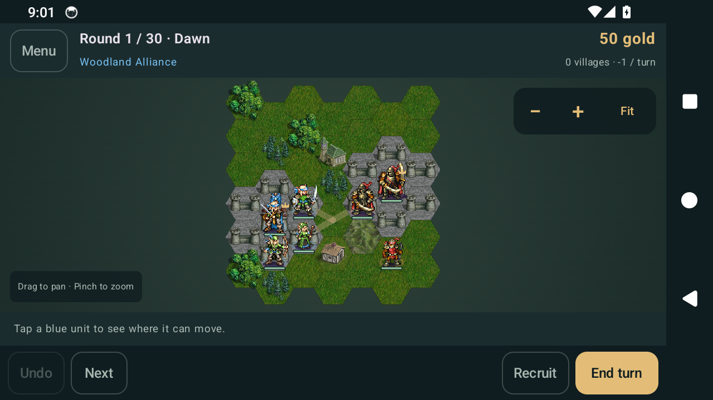

# Wesnoth Android: Frontiers

An unofficial, native Kotlin/Jetpack Compose Android reimplementation of The Battle for Wesnoth. Version 0.2 adds a substantial offline skirmish game and a sprite-based touch interface.

## Install

[Download the 0.2.0 APK](https://github.com/kingdomoVuigeil/wesnoth-android/releases/download/v0.2.0-prototype/wesnoth-android-0.2.0.apk) · [Release notes and source](https://github.com/kingdomoVuigeil/wesnoth-android/releases/tag/v0.2.0-prototype)

Android 8.0 or newer. Open the APK from Downloads, allow your browser/file manager to install apps when prompted, then tap Install. If you installed 0.1.0, uninstall that earlier prototype first: CI development APKs use debug certificates and may not update in place. Uninstalling removes that prototype's local data.

## Screenshots

Actual captures from the tested Android APK:



[Weapon selection preview](docs/screenshots/attack.png) · [All six test captures](https://github.com/kingdomoVuigeil/wesnoth-android/actions/runs/39019304194/artifacts/12096217022)

## Play

- Choose **New battle**, a map, and **Vs computer** or **Pass & play**.
- Tap a blue unit. Gold hexes show its movement range. Tap a destination to preview the path, then **Confirm move**. **Undo** reverses the last movement until another action commits it.
- Tap an adjacent enemy to compare weapons, hit chances and retaliation before attacking.
- Keep your captain on the keep to **Recruit** on vacant connected castle hexes.
- Capture villages for income and healing, protect your leader, and defeat the enemy leader within 30 rounds.
- Drag/pinch the map or use **+ / − / Fit**. **Next unit** finds another available ally.
- Progress autosaves after actions; **Menu** has manual save/load, the field guide and licenses.

## Included in 0.2

- 44 original Wesnoth sprites, animation frames and terrain textures, all bundled offline.
- Three skirmish maps, a deterministic tactical AI, and local pass-and-play.
- Terrain costs, unit-specific defence, friendly-unit traversal, zones of control, village capture and movement undo.
- Alternating strikes, matched-range retaliation, six damage types, resistances, time-of-day alignment, leadership and slow.
- Gold, village income, level-based upkeep, recruiting, healing/rest, XP and automatic single-path advancement.
- Movement and combat animation, health bars, team markers, leader crowns, accessible hex descriptions and responsive portrait/landscape layouts.
- Versioned saves including random state; no network permission, accounts, ads or runtime asset downloads.

## Build and test

JDK 17, Android SDK 37, and the included Gradle 9.6 wrapper:

```bash
./gradlew :engine:test
./gradlew :app:assembleDebug :app:assembleDebugAndroidTest :app:lintDebug
./gradlew :app:connectedDebugAndroidTest
```

Windows: use `gradlew.bat`. The APK is at `app/build/outputs/apk/debug/app-debug.apk`.

The pure Kotlin `engine` module has deterministic JUnit coverage for movement, combat, recruiting, healing, income, save/load, AI and victory. Android instrumentation tests exercise real onboarding, touch/zoom, path/attack previews, recruiting, save/load, orientation changes and an AI turn, and save screenshots for review. CI only publishes an APK after build, lint, engine tests and emulator tests pass.

The [0.2.0 release validation](https://github.com/kingdomoVuigeil/wesnoth-android/actions/runs/39019304194) passed all **22 engine tests and 5 Android UI tests**, Android compilation, lint, and the 44-file asset integrity check. Screenshots above were captured in that run on Android 14. Physical-device testing and broader Android-version coverage are still pending.

`python scripts/verify_assets.py` checks every bundled PNG against the provenance manifest. `scripts/fetch_assets.py` reproduces the import from a pinned upstream commit and validates the original copyright-table checksums.

## Limits and next steps

This is still an early reimplementation. It does not yet load upstream WML/Lua campaigns, add-ons, network games, saved games or replays. Traits, advancement choice, full ability/special coverage, ambush/fog/shroud and full upstream rules parity remain on the [roadmap](ROADMAP.md). The current unit roster and scenarios are a deliberately small, tested slice.

## Licensing

New code: copyright (C) 2026 Domokos Kovacs and contributors, GNU GPL v2 or later. See [LICENSE](LICENSE).

Original art and adapted numeric unit data come from Wesnoth 1.18.6, commit 1a2f96ab86808b94a34337502cfae86d94eb43d1. Art retains its individual GPL-2.0-or-later or CC-BY-SA-4.0 license and author credit. See [NOTICE.md](NOTICE.md) and [the exact asset manifest](app/src/main/assets/asset-provenance.json). Both full license texts are bundled in the app; each APK release includes complete corresponding source and build scripts.
